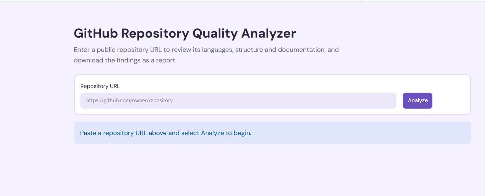
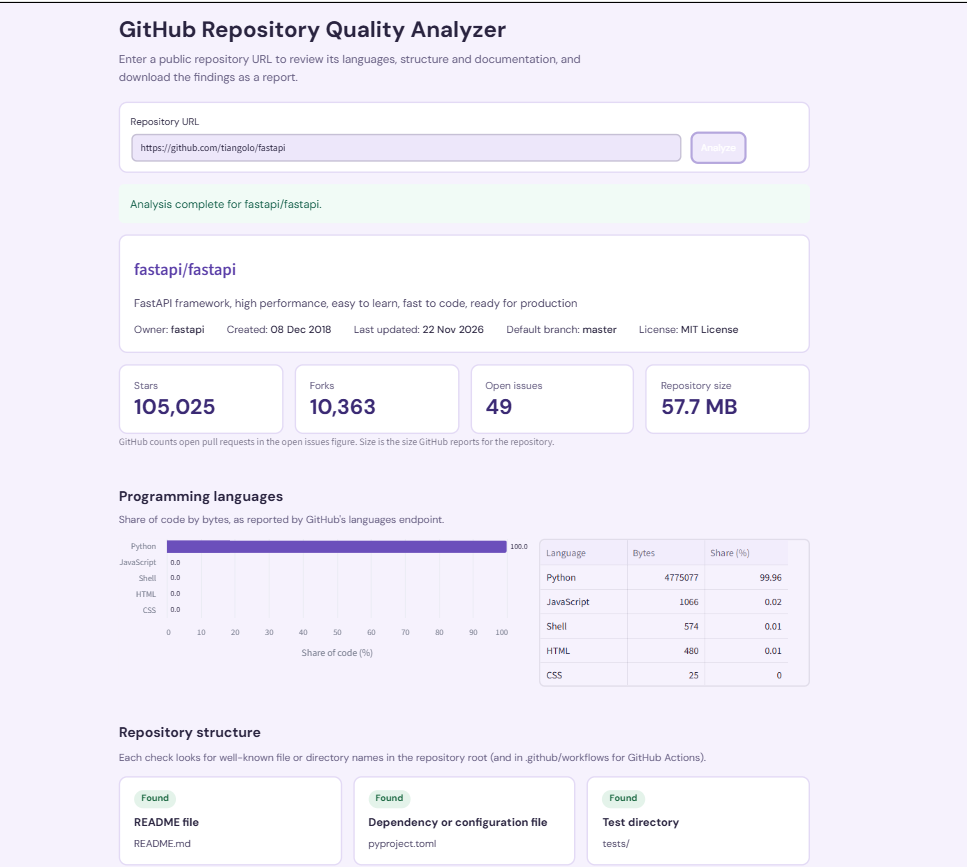
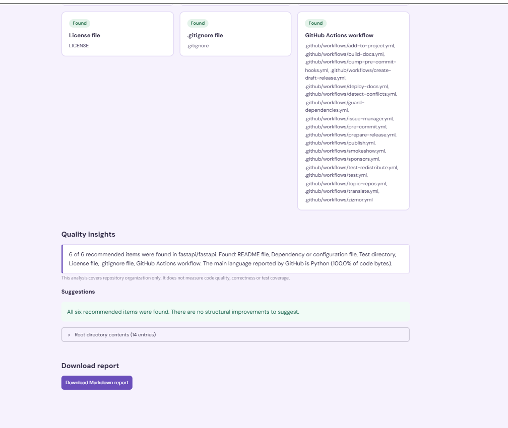

# GitHub Repository Quality Analyzer

A Python-based web application built with Streamlit that analyzes public GitHub repositories using the GitHub REST API. It displays repository information, programming language statistics, project structure checks, and suggestions for improving repository organization.

## Overview

The GitHub Repository Quality Analyzer helps developers review the basic organization of a public GitHub repository. It checks for important project files and provides a downloadable Markdown report containing the analysis results.

## Features

- **Repository Information:** Displays repository name, description, owner, creation date, last updated date, stars, forks, open issues, and repository size.
- **Programming Language Analysis:** Displays the programming languages used in a repository with percentages, charts, and a data table.
- **Project Structure Checks:** Checks for six recommended repository components:
  - README file
  - Dependency or configuration file
  - Test directory
  - LICENSE file
  - `.gitignore` file
  - GitHub Actions workflow
- **Improvement Suggestions:** Identifies missing components and explains why they are useful.
- **Markdown Report:** Generates a downloadable report containing the analysis results.
- **URL Validation:** Handles invalid GitHub URLs and supported URL formats.
- **Error Handling:** Handles missing repositories, private repositories, API rate limits, network errors, and empty repositories.
- **Optional GitHub Token:** Allows users to provide a GitHub personal access token to increase API rate limits.

## Technology Stack

| Technology | Purpose |
|---|---|
| Python | Main programming language |
| Streamlit | Web application interface |
| Requests | GitHub REST API communication |
| Pandas | Data handling |
| Altair | Language statistics visualization |
| Pytest | Automated testing |

## Project Structure

```text
github-repository-quality-analyzer/
│
├── .streamlit/
│   └── config.toml
│
├── Screenshots/
│   ├── dashboard.png
│   ├── analysis-results-1.png
│   └── analysis-results-2.png
│
├── .gitignore
├── README.md
├── app.py
├── github_analyzer.py
├── requirements.txt
└── test_analyzer.py
```

## Installation and Setup

### 1. Clone the repository

```bash
git clone https://github.com/Sara-png-ops/github-repository-quality-analyzer.git
```

### 2. Open the project folder

```bash
cd github-repository-quality-analyzer
```

### 3. Create a virtual environment

```bash
python -m venv .venv
```

### 4. Activate the virtual environment

For Windows PowerShell:

```powershell
.venv\Scripts\Activate.ps1
```

If PowerShell blocks activation, run:

```powershell
Set-ExecutionPolicy -Scope Process -ExecutionPolicy Bypass
```

Then activate the environment again.

### 5. Install dependencies

```bash
python -m pip install -r requirements.txt
```

## Running the Application

Start the Streamlit application using:

```bash
python -m streamlit run app.py
```

The application will open in your browser, usually at:

`http://localhost:8501`

Enter a public GitHub repository URL and click **Analyze Repository** to view the results.

## Running the Tests

Run the automated test suite using:

```bash
python -m pytest -v
```

The tests use mocked GitHub API responses to check URL validation, API response handling, error handling, repository structure checks, and report generation.

## Application Screenshots

### 1. Dashboard



The main interface where users enter a public GitHub repository URL and start the analysis.

### 2. Repository Analysis



Displays repository information and programming language statistics.

### 3. Quality Checks and Recommendations



Displays repository structure checks, missing components, and improvement suggestions.

## Methodology

The analyzer uses information retrieved from the GitHub REST API.

- **Language Statistics:** Calculates the percentage of each programming language using the byte counts returned by GitHub.
- **Structure Checks:** Searches for recommended files and directories in the repository root and GitHub Actions workflow directory.
- **Analysis Summary:** Reports how many of the six recommended components were found and identifies missing components.

## Limitations

- Only public GitHub repositories are supported.
- The analyzer checks repository organization, not the actual quality or correctness of source code.
- It does not measure code quality, security vulnerabilities, or test coverage.
- Structure checks are based on file and directory names.
- Files located in certain nested directories may not be detected.
- Unauthenticated GitHub API requests have rate limits.

## Future Improvements

- Add checks for common nested project directories.
- Include commit activity and contributor statistics.
- Add side-by-side repository comparison.
- Support PDF report generation.
- Integrate automated testing through GitHub Actions.

## Author

**Sara Subhan**


